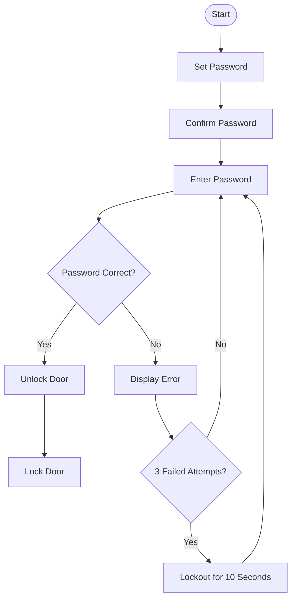

# Smart Door Lock System Using 8051

An electronic door lock system based on the AT89C51 microcontroller, featuring password-based access control, a 4x4 matrix keypad, and a 16x2 LCD.

## Project Overview

This project implements a password-based electronic door lock system using the 8051 microcontroller. Users can set a password, enter it through the keypad, and verify their credentials to control door access.

The LCD provides instructions and system status during operation.

## Features

- Password setup and confirmation
- Password-based access verification
- 4x4 matrix keypad input
- LCD 16x2 status display
- Unlock indication using LED
- Wrong password warning
- Temporary lockout after 3 failed attempts (10 seconds)

## Hardware Components

| Component | Description |
|---|---|
| Microcontroller | AT89C51 |
| Display | LCD 16x2 |
| Input | 4x4 Matrix Keypad |
| Indicator | LED |

## Software & Development Tools

- SDCC (Small Device C Compiler)
- Proteus 8 Professional
- Embedded C
- 8051 Microcontroller Architecture

## Project Structure

```text
Smart-Door-Lock-System-8051/
├── Source_Code/
├── Proteus/
├── Images/
├── Documentation/
└── README.md
```

## System Flow



## Screenshots

Project circuit diagrams and simulation results are available in the `Images/` directory.

## Author

**Ngo Huy**

Microelectronics Engineering Student  
Ho Chi Minh City University of Foreign Languages and Information Technology (HUFLIT)
