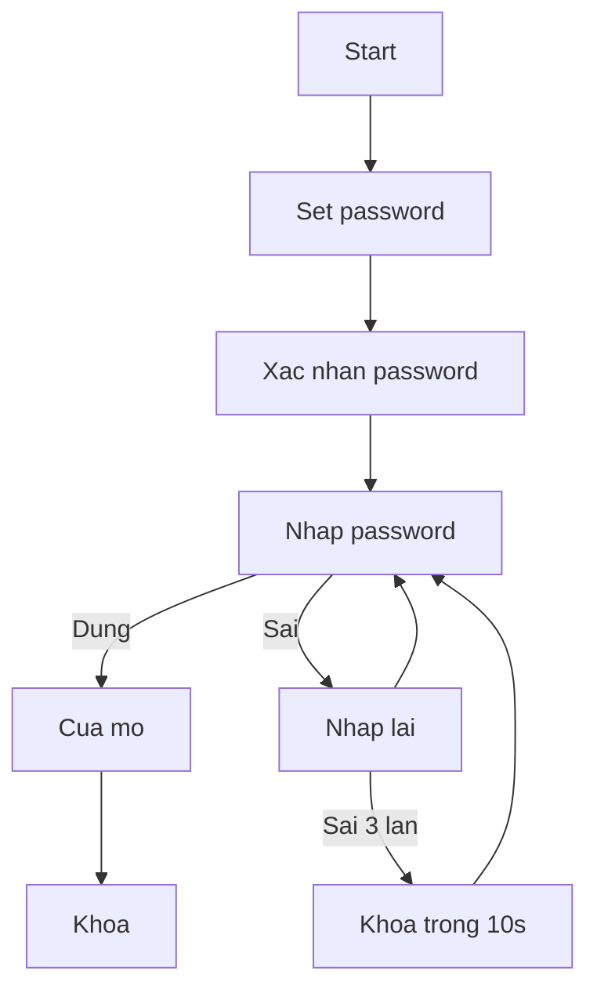

# Smart Door Lock using 8051

Electronic Door Lock System using AT89C51, LCD 16x2 and Keypad 4x4.

## Features

- Password setup
- Password verification
- LCD display
- Keypad input
- Unlock indication
- Wrong password warning

## Hardware

- AT89C51
- LCD 16x2
- Keypad 4x4
- LED

## Software

- Proteus
- SDCC

## System Flow

## Screenshots

(ảnh ở thư mục images)

## Author

Ngo Huy